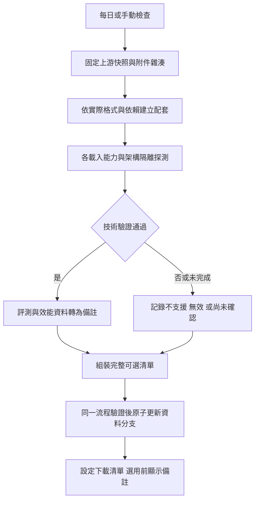

# 模型自動維護與設定備註設計

初稿：2026-10-24；實作更新：2026-10-27。0.13.0 pre-release 已實作 reader、原生配套支援、備註 UI、探測與發布流程。實際部署與操作以 [模型維運說明](../../MODEL-CATALOG-MAINTENANCE.md) 為準，測試以 [0.13.0 驗證紀錄](../../releases/VERIFICATION-0.13.0.md) 為準。以下方案表及草案保留為設計沿革，當中的「現有／尚未實作／未授權」指初稿時點；正式 workflow 在 `.github/workflows/model-catalog-maintenance.yml`，不是本目錄的示例。內建模型與上游 pin 沿用，未實際安裝新版。

## 決策與可行性

**可以在 GitHub 自動維護「技術上可用的模型清單」；評測及效能只形成備註。** 日常資料更新不需維護者逐次批准；新格式或新核心能力才需要開發。流程不依賴 AI，也不需要使用者電腦常駐。

| 檢查結果 | 處理 |
| --- | --- |
| 來源／雜湊、格式、依賴、載入、基本運作皆通過 | 列入可下載／可選清單 |
| 評測退步、部分集合退步、較慢、記憶體較多、預覽版、尚未評測、其他使用差異 | 仍可選；UI 呈現備註及選用確認 |
| 未支援的 magic／格式版本、附件種類、核心能力 | 目前版本不支援；保留發現紀錄，支援後重測 |
| 損壞、錯誤配對、無法解析／載入、基本操作崩潰 | 該組配套未通過技術驗證，不可宣稱可用 |
| API 限流、網路中斷、runner 故障、測試未完成 | 尚未確認，保留上一份有效資料並重試，不當成模型品質或不相容結論 |

技術准入不含準確率、速度或記憶體門檻。評測無法執行時，只要技術驗證完成，模型仍可發布，備註為「尚未評測」；測試無回應／崩潰若發生在載入或基本運作階段則另行處理。不得只因有新標籤就判斷可用，也不得因版本號較舊或是 prerelease 就排除；prerelease 只加備註，GitHub draft 尚未公開則不探索。

## 現有程式的邊界

| 位置 | 已確認行為 | 本次規劃 |
| --- | --- | --- |
| `ui/Models/ModelCatalog.cs` | 同時讀上游 Releases 與本專案 main 的 format:1；標籤限定 model-v／classes-v，固定下載 bigram.sjlm、classes.sjc | v2 附件陣列、能力過濾、備註及新命名 |
| `shared/src/models.rs` | 核對來源、classes 配對及 Windows 映射等價；含 kn.sjkn／trigram.sjt3／tinylm.sjtl 時明確拒絕 | 分角色驗證與載入能力對照，不直接移除拒絕條件 |
| `ui/MainWindow.Models.cs` | 下載後選入草稿，主視窗儲存才套用；沒有模型備註確認 | 確認成功才變更草稿，取消回復 |
| `.github/workflows/release.yml` | 程式版本變動／手動才跑發行建置；沒有模型排程 | 模型維護獨立，不更改版本或重製安裝包 |
| `UPSTREAM-CHANGES.md` | Windows 沒有上游完整語意修正殼層，附加模型不出貨 | 先做契約／載入整合，不能聲稱只下載就獲得新能力 |

截至設計日，上游模型表仍是 model-v6／classes-v5，另外列出 kn-v1、SJ-CX-1-7.7M、SJ-SR-6-14M、SJ-CL-1-68K。這份列表是發現輸入，不是 Windows 已支援清單。上游新對外名稱使用 SJ-*，實際附件名稱仍有 bigram.sjlm 等，因此不能再把 release 前綴當格式。[上游模型表](https://github.com/Nanako0129/shanjie/blob/main/data/models.tsv)、[命名規則](https://github.com/Nanako0129/shanjie/blob/main/docs/releases/README.md)。

## 交付檔案與責任

本目錄中的 [schema](catalog-v2.schema.json)、[範例](catalog-v2.example.json) 與 [workflow 草案](model-catalog-maintenance.yml.example) 都是設計資料；不在 .github/workflows 下，不會被 GitHub 執行。範例的 example_only=true 及文字明示非實測，正式發布器必須拒絕。

以下是下一階段預定實作的位置，目前尚未建立：

| 預定檔案 | 職責 |
| --- | --- |
| `.github/workflows/model-catalog-maintenance.yml` | 每日／手動發現、平台探測、組裝與資料發布 |
| `scripts/model_catalog/discover.py` | 讀 Releases、固定來源快照及前次狀態，建立附件與候選配套計畫 |
| `scripts/model_catalog/profiles.json` | 已審查載入能力、固定程式來源／工具鏈、平台架構與公開測試輸入 |
| `scripts/model_catalog/probe.ps1` | 在隔離目錄建置／呼叫指定版本的 probe；所有原生載入均在子程序 |
| `scripts/model_catalog/assemble.py` | 整合結果、產生備註、驗證 schema 與語意不變量、比對上一版 |
| `scripts/model_catalog/publish.py` | 重查來源及分支 HEAD、只寫允許的資料路徑、原子發布 |
| `scripts/model_catalog/check_contract.py` | 結構及語意契約測試；不下載或套用模型 |
| `windows/src/bin/shanjie-model-check.rs` | 以本版共享驗證、核心與 Windows 映射執行 probe；不註冊 IME |
| `shared/src/models.rs`、`ui/Models/ModelCatalog.cs` 等 | v2 reader、備註 receipt、能力判定與 UI；Linux 另接相同資料契約 |

## GitHub 執行流程

### 排程與狀態

- 正式部署後預設每日 UTC 01:23（台北 09:23），避開整點；保留 workflow_dispatch 的 verify／publish 模式。第一階段只乾跑，確認資料與 UI 後才設定 MODEL_CATALOG_AUTOPUBLISH=true。草案的副檔名不會啟用排程。
- 排程跑在預設分支，程式碼以本次 workflow 的固定 SHA 為準。profiles 只指向本專案已審查來源的完整 commit SHA／工具雜湊，不用上游最新 main 編譯驗證器，不執行 Release 說明中的命令。
- Releases 完整分頁；依 release ID、asset ID、digest／檔案實算雜湊及來源快照建立 cache key，不能只看 tag 或版本大小。舊模型仍保留，沒有「只發布最新」或分數篩選。
- classes 的檔頭綁定主模型 SHA-256 與詞彙數，直接由 parser 核對；其他附加模型逐類實作依賴檢查。相容候選按依賴圖產生，不任意交叉組合附件、不默默略過要求的側檔。
- 新能力未支援者進入 pending 報告；擴充 profiles／程式支援後自動重試。網路或 runner 故障與 unsupported／invalid 分開。無異動不寫空提交；例行成功只留下 Actions 摘要，真正異常留下報告。
- GitHub 排程可能延遲／漏執行，公開 repo 60 天無活動可能停用；不以每日空提交假裝有資料變動。紀錄最後成功檢查時間於 run 摘要，手動可補跑；正式啟用時將限制寫入維運說明。[GitHub schedule 文件](https://docs.github.com/en/actions/reference/workflows-and-actions/events-that-trigger-workflows#schedule)。

### Probe 與比較

probe 必須用實際對應程式的 parser／映射／載入路徑，不能另寫一個較寬鬆 parser 當通過證據。載入能力 profile 是不可變的實作契約；任何會影響載入的程式或配置改動都建立新 profile，不覆蓋舊 profile 的含義。

- Windows x64／x86 分別測試原始解析、主模型／詞類配對、映射前後等價、真正載入及公開短句基本運作。其他平台只對確實測過的 target 提供 usable；不因 Windows 通過就推論 Linux 通過。
- probe 的 model hash、profile、source commit、架構及結果須全部吻合計畫；先核對檔案大小、magic、數量與上限，再交子程序完整解析。超時／runner OOM 保留執行環境資訊，不能直接當成品質退步。
- 使用工作目錄內的全新 profile／模型路徑，停用學習；不讀安裝目錄、使用者 profile、詞庫或診斷報告。不安裝、註冊或控制 Explorer。
- 評測使用公開資料集及固定 SHA-256、明確聊天／書面／混打設定；基準配套也在同一實作與 runner 重跑。每個集合分開顯示分母、基準／候選正確數及差異；不可混用不同分母、歷史 Windows 或 macOS 成績。
- 速度與記憶體記錄同場條件、樣本及測量方法；無可比條件標示未測。分數、耗時、RSS 都不進技術准入公式。評測錯誤輸出 not_evaluated 與備註，不改 technical usable。
- 每種目標 profile 的結果獨立；至少一個已核對 target 可用才發布該配套，其他 target 不可冒充可用。執行中斷不撤掉既有有效記錄，待補測完成再新增可用 target。

## 清單與相容契約

### v1 與 v2

根目錄 MODEL-CATALOG.json 維持 format:1 與現有三組，讓現有 0.12.2 繼續使用。這版既無備註 UI 又忽略未知欄位，不能靠多加 JSON 欄位要求它顯示確認。因此新的自動維護項目只發 v2；先更新一次 reader／UI，之後支援相同能力的已發行程式才能自行取得新配套，不用每次更新二進位檔。

建議新增 model-catalog **純資料分支**，v2 端點為：

`https://raw.githubusercontent.com/tavricccc/shanjie-multiplatform/model-catalog/MODEL-CATALOG-V2.json`

分支及端點尚未建立／啟用。模型本體仍從 Nanako0129/shanjie 的正式附件下載，不把模型大檔、個人資料或測試輸入回傳到本專案。資料分支只允許：

- MODEL-CATALOG-V2.json：給設定 reader 的完整資料。
- MODEL-CATALOG-STATE.json：已見附件身份／重試狀態，不含 token 或私人路徑。
- reports/*.json：按內容雜湊命名的技術證據、公開統計及 pending 摘要；不含完整模型及原始私人內容。

v2 的主要欄位：

| 欄位 | 用途 |
| --- | --- |
| format、revision、generated_at、example_only | 協定、語意資料修訂、時間及禁止誤發布範例 |
| assets | 角色、實際檔名、格式 magic／版本、release、大小、SHA-256 與依賴附件雜湊 |
| required_capabilities | 核心／reader 必須具備的能力；未知能力才不可選 |
| compatibility | 各 target／固定載入 profile 的驗證結果與 source commit |
| advisories、advisory_revision | 純文字備註、結構化實測資料與確認修訂，完全獨立於可用判斷 |

schema 只驗證形狀；下列語意檢查另由 assemble／reader 實作：

1. model ID 唯一；一組資產角色／檔名唯一且至少有 bigram。需要詞類的格式必須提供 classes；真正不需詞類的舊格式則由明確的 classless 能力處理，不能替需要詞類的模型省略附件。所有 requires_assets 都存在且圖無環；內嵌配對必須吻合。
2. asset release 不限舊前綴，角色也不憑前綴推斷；URL 由固定上游 repo、release 與檔名組成。禁止相對路徑穿越、其他下載來源或可執行附件。正常 GitHub 附件 CDN 重新導向仍可使用，下載後再次核對完整雜湊。
3. model ID 由整組檔案、相依與必要能力的 canonical digest 產生，範例 ID 除外；同一 tag 換檔不能覆寫舊配套身份。上游被移除／換檔時保留本機已驗證模型；新下載標示來源不可核對，不靜默抓新檔替代。
4. compatibility 至少有一個 usable 的已知 profile 才進公開模型清單。client 只接受自己的已知 profile／target 且 required_capabilities 全部滿足者，不因版本號較大推定支援。最低程式版本由 profiles 對照推導。
5. advisory_revision 只取正規化備註／比較資料的雜湊；catalog revision 取語意內容，不包含 run ID、檢查時間等每天會變的欄位。同資料重跑不得產生新 ID 或重新要求確認。
6. benchmark 的 corrected／sample_count 界限與雙方分母一致；不同基準／設定的結果不可相減。缺資料標示未評測，不補造數字。advisory 的 evidence 僅是資料，不影響技術通過狀態。
7. example_only=true、缺少已計畫的技術結果或結果與候選雜湊不符時禁止發布。某一候選失敗不得抹去其他可用模型；同步缺漏／來源錯誤不把已發布清單清空。

### 發布權限與競態

一般工作 contents:read；只有 publish 工作 contents:write。同一 workflow 內完成驗證再發布，避開用 bot 提交後期待另一條 push／PR CI 自動接續的依賴；不需要每個資料更新都手動批准或個人 PAT。真正啟用前仍需核對 repo 的 Actions 權限與資料分支 ruleset。[GITHUB_TOKEN 權限](https://docs.github.com/en/actions/tutorials/authenticate-with-github_token)、[workflow 觸發限制](https://docs.github.com/en/actions/how-tos/write-workflows/choose-when-workflows-run/trigger-a-workflow)。

以 Git tree／commit API 將允許的資料檔在同一 commit 寫入，commit parent 固定為讀到的資料分支 HEAD；更新 ref 使用非強制 fast-forward。若其間分支變動即放棄發布，重新讀取並重組；不 force push、不覆蓋 main，也不啟動輸入法 Release。Git 歷史保留上一份清單供回復，回復用新 commit 指回既有有效資料。[Git refs API](https://docs.github.com/en/rest/git/refs#update-a-reference)。

publish 前重新核對候選來源身份及證據；API／下載狀態失效先重試。只比較「本地算出的新 hash」不足以信任來源，須與固定來源快照的上游雜湊／附件 digest 對上；拿不到可靠來源時是 unverified，不是用自行算出的 hash 自我背書。

assemble 的內部交付物另含 publication-plan.json，固定預期資料分支 HEAD、workflow SHA、候選／probe／來源證據摘要及准許寫入的檔案雜湊。這份檔案只供 publish 驗證，不屬於允許發布的資料。publish 必須重新驗證它與實際資料一致；不能只信任呼叫端傳入的 --allow 路徑而略過固定白名單。

## UI 與本機保存

- 清單行顯示配套名稱、可用狀態與備註摘要。內容使用純文字及 app 自己產生的指標表格，不執行上游 HTML、Markdown 或命令；限制字串長度及整份清單大小。
- 「評測低於基準」「尚未評測」「較高資源需求」「預覽版」與已知差異都可選。若同時有進步／退步，分開列出；不做會掩蓋部分退步的單一總分。
- 線上可以先看備註再下載。點「下載並選取」時先確認，成功下載驗證後才改草稿；若其間備註修訂變了，套用前重新確認。只下載不切換不必變動模型。
- 已下載清單、匯入／重新掃描及重新選用都走同一個選用入口。先暫存原選取，再顯示「仍然選用／取消」，確認後才寫入草稿；取消不改原模型、其他草稿或設定檔。主視窗儲存仍是唯一套用步驟。
- 確認紀錄綁定 model ID＋advisory_revision＋本次設定草稿；同一次選用不在下載與儲存重複問。下一次主動改選可再提示；遠端新增備註只更新顯示，不能自動換模型或中斷輸入。
- receipt 另存完整附件／能力／來源／備註資料，與經驗證模型一併原子完成。保留舊 receipt 可讀；未知 reader 格式明確顯示不支援。離線仍能讀本機備註；只有 metadata 缺漏但本地模型可用時顯示「尚無評測／備註資料」，不假稱已測通過。
- 既有 learning、字典、profile 與 Models 保持沿用，內建 model-v6＋classes-v5 繼續作為可用備援。本次設計不要求改預設配套。

## 執行順序與驗收

1. **M1／M2**：先鎖定 schema、profiles 與來源身份契約；用目前三組公開配套確認新 reader 不破壞既有驗證。新 SJ-* 標籤但相同已知格式的 fixture 應可通過。
2. **M3／M6**：實作純資料發現與 probe，輸出技術結果及備註；退步、未評測、效能差異的配套仍是 usable。未知 magic、錯誤 SHA、配對錯誤必須分清狀態。
3. **M5**：接 UI 及 receipt。驗收有備註選用、取消／離線／同次不重複提示、其他草稿不變、較新備註及未知欄位處理；所有選用入口一致。
4. **M4／M8**：完整 workflow 先乾跑，不建資料分支；檢查去重、來源換檔、API 限流、缺結果、競態、權限不足及示例誤發布防護。確認後才首次建立資料分支、指向 v2 端點並啟用自動發布。
5. **M7**：輔助模型逐類做核心／平台整合及契約回歸，支援後增加不可變能力 profile。同一格式後續新資料即可沿用自動維護，不需每次更新程式。

這份設計沒有新增執行中的 GitHub workflow、沒有真實 probe 成績，也沒有取得現有 repo 設定的寫入權限；實作及部署完成後才可把對應 TODO 標為完成。
