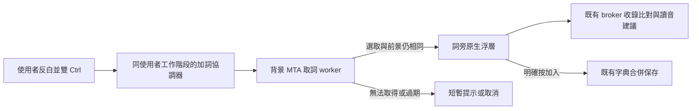

# 唯讀文字反白加詞：定位與實作方向

初稿：2026-10-24；實作更新：2026-10-27。0.13.0 pre-release 已實作 `windows/src/word_helper.rs`、獨立 UIA worker 與輔助程式持有的浮層，隔離回歸見 [驗證紀錄](../releases/VERIFICATION-0.13.0.md)。本文件後面的定位與方案比較保留為設計沿革；實際狀態以本段與驗證紀錄為準，真正宿主及登入／DPI 尚未驗收。

實際入口採一般使用者 Raw Input，不依賴來源 TSF 的可編輯狀態；浮層維持不啟用視窗，只在浮層存在且來源仍為前景時，暫時用短 WH_KEYBOARD_LL 回呼轉送允許的讀音鍵／Enter／Esc／Ctrl+A，關閉即卸除，其他快捷鍵放行。取詞在有界、可終止的 MTA 子程序執行，限本次前景的 GetSelection；不擷取使用者私人畫面作測試。

## 需求與邊界

- 一般可反白的唯讀內容也能在雙 Ctrl 後於詞旁開啟加詞浮層，例如 Codex 回覆區、網頁與聊天訊息。沒有輸入游標／可編輯 context，不應直接拒絕。
- 沿用 1–32 個漢字的字典格式。先顯示一組建議讀音，不做破音字／多音字的語境判定，也不為此讀取未反白的上下文；找不到完整建議才提示補填。
- 核心維持登入使用者身分，取詞與浮層在同一使用者互動工作階段的一般權限輔助程式中處理，不新增 SYSTEM 服務或修改 UAC。
- Excel 儲存格取詞依使用者決定取消需求，不列本功能或驗收目標；不把取消需求稱作已修復。
- 只修改善解個人字典，不寫回來源文字、不發送訊息、不使用剪貼簿或 OCR。密碼、無選取、超長或不合字典格式的內容不進入保存。

「可反白」與「Windows 能取得選取範圍」不同。目標須提供 TextPattern／選取文字介面，否則先回報不支援；不承諾所有畫面皆可讀。尚未驗證 Codex 回覆區的 provider，這是第一階段應實測的目標，不是既定成功案例。

## 目前定位

| 來源 | 實際限制 | 後續變更 |
| --- | --- | --- |
| [tsf/keys.rs](../../windows/src/tsf/keys.rs) 的 ctrl_event | 雙 Ctrl 由 TSF 回呼判定，只有取得 context 才呼叫 show_word | 建立不依賴文字編輯的手勢入口，舊入口去重 |
| [tsf/add_word.rs](../../windows/src/tsf/add_word.rs) 的 editable／Request／word_current | 拒絕 readonly、disabled、empty context；請求與選取綁 ITfContext | 唯讀請求改綁前景來源、選取與 request ID，不冒充可編輯 context |
| [selection_text.rs](../../windows/src/selection_text.rs) 的 inspect／same_selection／run | 明確拒絕唯讀，要求 UIA element 的 PID 與目前宿主程序相同；只從 focused element 取詞 | 新路徑允許一般唯讀與跨程序，且處理焦點不是文字元素的情形 |
| [tsf/modifiers.rs](../../windows/src/tsf/modifiers.rs) | WH_GETMESSAGE 僅觀察當前宿主執行緒的按鍵活動 | 不能當成整個使用者桌面的雙 Ctrl 入口 |
| [word_popup.rs](../../windows/src/word_popup.rs) 與 tsf/keys.rs | 原生浮層本身不啟用；文字鍵／Esc 由 TSF 轉送，owner／失焦處理也以來源宿主為前提 | 輔助程式須自己持有 UI、取消與輸入路由，不能直接照搬 HWND owner |
| [shared/words.rs](../../shared/src/words.rs) 與 [broker/session.rs](../../windows/src/broker/session.rs) | 已有完整詞／逐字建議、收錄比對與合併儲存，不需要來源輸入的注音 | 重用這些模組，不另建第二套詞庫保存規則 |

這些是已核對的程式分支，不代表某個實際應用只受單一分支影響。只移除 IsReadOnly 檢查，仍無法補上無 TSF context 的觸發與浮層按鍵路由；只提升核心也不會提升宿主 DLL 的取詞權限。

## 建議架構

預定新增獨立的 shanjie-word-helper 使用者程式（名稱可在實作時調整），每個 user／session 一例；模型核心仍只處理模型、詞庫與既有 broker 請求。UIA 工作可放在專用 worker 子程序，避免 provider 卡住時影響輸入或核心。

來源視窗、協調器訊息視窗與浮層視窗須分開：來源 HWND 只作定位／驗證參考；浮層由 helper 自己持有，沒有工作列獨立視窗，不向來源程序注入程式或 SetParent。跨程序 owner、失焦、DPI 及點擊取消另做隔離回歸，沿用 r2 已驗收的非同步關閉與回呼存活原則。

### 手勢入口與去重

1. 首選驗證 Raw Input 接收背景鍵盤事件，以同使用者 session 的隱藏訊息視窗承接。只保留 Ctrl 側別、按下／放開、時間與其他按鍵活動計數，不產生文字或永久按鍵紀錄，不使用 RIDEV_NOLEGACY 改變原程式收鍵。
2. 沿用已完成的純雙 Ctrl 規則：相同側、配置間隔、單次按住上限、repeat 不是新按鍵；組合鍵、失焦或不同側取消。不因增加唯讀功能改動 Shift 切換。
3. Raw Input 若在目標環境不足，再測 WH_KEYBOARD_LL 備案；hook 用獨立訊息執行緒，回呼只做狀態更新／派送並立刻傳遞，禁止在其中跑 UIA、詞庫比對、管道或視窗關閉。維持原按鍵傳遞，不攔截一般 Ctrl 組合。
4. helper 與原 TSF 入口必須經同一協調／請求 token 仲裁，不只各自加 debounce；以來源 root HWND、gesture 時序與目前請求世代合併，一次手勢只開一個浮層。協調器不在線時保留原可編輯欄位入口，不能讓既有功能依賴新 helper 才能運作。

API 依據：[Raw Input](https://learn.microsoft.com/en-us/windows/win32/inputdev/about-raw-input)、[LowLevelKeyboardProc](https://learn.microsoft.com/en-us/windows/win32/winmsg/lowlevelkeyboardproc)。Raw Input 是首選待驗證方向，尚未宣稱在所有目標程式都收到事件。

### 取詞與請求有效性

- 在手勢完成時固定 source root HWND、來源 thread／process、session／desktop、request ID 與時間；跨程序焦點資訊用來源執行緒查詢，不能拿 helper 自己的 GetFocus 當使用者焦點。[GetGUIThreadInfo](https://learn.microsoft.com/en-us/windows/win32/api/winuser/nf-winuser-getguithreadinfo)。
- UIA 在不持有視窗的獨立 MTA 執行緒中操作；provider 呼叫有期限與取消，worker 卡住只回收本次確定身份的自建程序，不停止來源應用。UIA COM 物件不跨 apartment 隨意傳遞。[Microsoft threading 指引](https://learn.microsoft.com/en-us/windows/win32/winauto/uiauto-threading)。
- 先試 focused element 的 TextPattern；若焦點落在容器或工具列，只在本次前景 root 的文件／祖先範圍內作有界探索，限制深度、節點及時間，不掃整個桌面、不讀 DocumentRange 來猜選取。
- 只使用 GetSelection 的單一非空範圍，最多讀 65 個 UTF-16 code units 以辨識超限；驗證 1–32 個漢字，再取 bounding rectangles 的有效位置。IsReadOnly=true 本身不再是拒絕理由；缺少可編輯性屬性也不等於密碼，密碼狀態另外檢查。[GetSelection](https://learn.microsoft.com/en-us/windows/win32/api/uiautomationclient/nf-uiautomationclient-iuiautomationtextpattern-getselection)。
- 不能要求 element PID 等於 helper PID。Chromium／WebView 可能由不同程序提供元素，須以選取的 UIA identity、祖先所屬 foreground root 及可驗證來源綁定；無法確認屬於本次來源就拒絕，不以單純 PID 相同或游標位置猜測。
- 回傳值只含文字、選取識別、來源視窗、位置與 request ID；顯示前再次確認前景與選取。切換程式／文件、改選取、關閉來源或較新請求到達時，舊結果失效。浮層自己的按鈕互動與來源失焦要能區分。
- 無 provider、沒有 selection、權限受阻、格式不符與逾時分開回報。一般權限先做；管理員視窗若真的被阻擋，另記證據與範圍，不在這次規劃中自動加 SYSTEM／UIAccess。

Windows 服務不適合直接操作登入桌面；一般權限的 per-session helper 符合本需求，不需要把算詞核心變成服務。[Microsoft 服務互動指引](https://learn.microsoft.com/en-us/windows/win32/services/interactive-services)。

### 浮層、讀音與保存

- 浮層仍在反白詞附近顯示，沿用主題、DPI 與畫面邊緣定位。背景比對晚回、取消／連點及快速重開均沿用 request／revision 防護，不在持有共享狀態借用時同步切換焦點或銷毀視窗。
- 首階段採建議讀音模式：完整詞可查到時取詞庫提供的一組，沒有才逐字組合；不解析破音字語境，不推定使用者先前輸入過的注音。
- 按鈕加入／取消與 Esc 必須由 helper 自己的入口處理，不能等 readonly 來源的 TSF 轉送。若保留手改讀音，須由浮層自身的原生輸入控制項明確承接，不能把文字鍵送回來源或在全域 hook 中組字；這部分焦點轉移要單獨驗收。
- 查不到完整讀音時保持草稿，不自動保存空讀音；顯示原因並允許補填。原字典已收錄／讀音不同／模型收錄等比對沿用，不把「詞庫有字」與「模型有完整詞」混成同一結果。
- 使用既有 broker 請求與同使用者字典鎖／合併／原子發布；只有使用者明確按加入才寫入。取消不改字典、學習、profile 或來源文字。

## 實作順序與驗收

| 階段 | 驗收內容 | 通過後才能宣稱 |
| --- | --- | --- |
| W1／W2 | 私有桌面的自建 readonly Edit／Document、空選取、密碼、超長、不同 process 的 owned provider、掛住／錯誤 provider、純雙 Ctrl 與組合鍵 | 獨立事件與跨程序取詞流程可運作 |
| W3／W4 | helper 浮層加入／取消、Esc、快速重開、來源關閉／改選、建議讀音、收錄比對、字典原子保存、原文不變 | 功能在隔離情境可操作且資料正確 |
| W5 | x64／x86、DPI／邊緣、跨程序 owner 與 Chromium 式 provider、同時有 TSF 舊入口、舊 worker 晚回 | 不重複開窗、不退回 r2 焦點／關閉問題 |
| W6 | 以公開「回家」等詞例在 Codex 回覆區、一般網頁與可提供 TextPattern 的唯讀文件取詞；記事本可編輯欄位對照 | 逐一記錄已實測的真正宿主支援範圍 |
| W7 | 同使用者登入、關閉／重啟、設定開關與多工作階段單例 | 啟動／退出與既有核心互不干擾 |

Excel 儲存格取詞不在任何階段驗收。真實桌面測試前先完成自建隔離案例，再按當時使用者授權範圍操作；本次定位沒有啟動 helper、註冊鍵盤觀察、讀取私人選取或改動系統權限。
